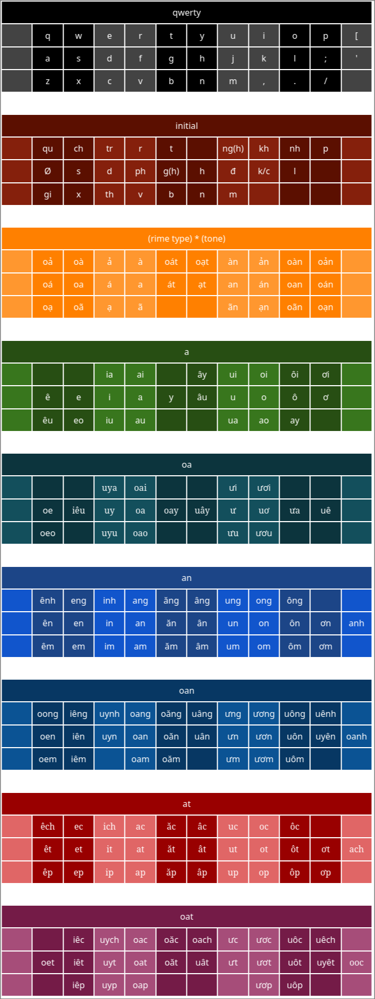

# Rime Key Vietnamese
[Rime](https://rime.im/) Triple Key Vietnamese

## Installation

Dependency:
- [KathrynCG/rime-chunom-cakegao](https://github.com/KathrynCG/rime-chunom-cakegao)

[plum](https://github.com/rime/plum) Installation command: `bash rime-install chenlin014/rime-triple-vietnamese:full KathrynCG/rime-chunom-cakegao`

Install default configuration: `bash rime-install chenlin014/rime-triple-vietnamese:default_config`

## Default Layout

## About
This is a input method that can type vietnamese syllables in three keys.

## Behavior
Assume that "in/" maps to "nam".
- Capitalization
  - in/ -> nam
  - In/ -> Nam
  - IN? -> NAM
- Auto space
  - in/in/ -> nam nam
- Auto commit
  - in/ + !
    - commit "nam!"
- Commit Keys
  - space
    - commit + (space)
  - enter
    - commit + (enter)
  - left shift
    - commit and switch to ascii mode
  - right shift
    - commit without switching

## Resource
- Luong Hieu Thi
  - [All syllables in Vietnamese language](https://www.hieuthi.com/blog/2017/03/21/all-vietnamese-syllables.html)
  - [common-vietnamese-syllables.txt](https://gist.github.com/hieuthi/1f5d80fca871f3642f61f7e3de883f3a)
- tunc2112
  - [vietnamese-syllable-regex](https://github.com/tunc2112/vietnamese-syllable-regex/)

## Todo
- [ ] Designing a properly layout
  - [ ] Finding data on Vietnamese syllable frequency
- [ ] Checks
  - [ ] Coverage of syllables
  - [ ] Tone mark placements
- [ ] Supporting old and new tone marking styles
  - A switch for tone mark style
- [x] Output for shorter codes
  - 1: onset
  - 2: final
- [ ] Integrating input methods like Telex or VNI
- [ ] Entering Vietnamese letters in ascii mode
- [x] Supporting Chữ Nôm (𡨸喃) and Chữ Hán (𡨸漢)
- [ ] Symbols
  - Other motified Latin letters
  - Korean Hangul
  - Japanese Kana
  - Greek Alphabet
  - Emoji
  - etc.
